# Naruto Battle Simulator
### Turn-Based Combat • Adversarial Search • Intelligent Decision Making

> **Project:** Naruto Battle Simulator Using Adversarial AI  
> **Core Idea:** Build a playable battle simulator where the opponent doesn't just attack randomly — it **thinks, evaluates, searches, and adapts**.

---

##  01 — The Big Picture

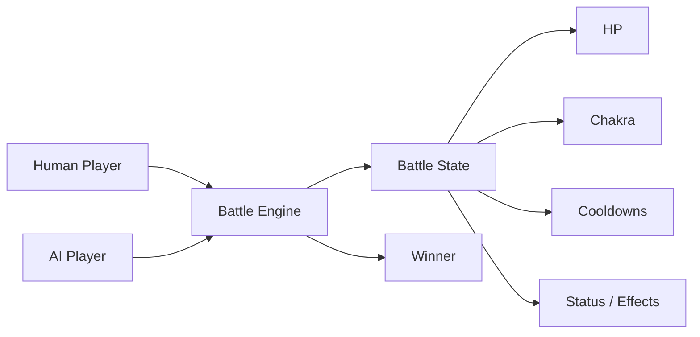

The project combines a **game environment** with progressively stronger AI techniques.

### The AI Journey

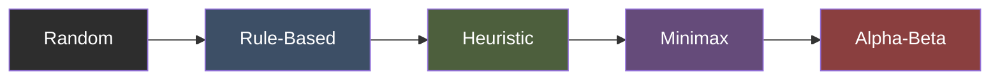

**Goal:** demonstrate how decision quality and computational cost change as the AI becomes more sophisticated.

---

#  02 — What Are We Actually Building?

A **turn-based Naruto-inspired combat simulator** where:

-  Characters have different combat statistics.
-  Jutsu consume Chakra and may have cooldowns.
-  HP determines survival.
-  AI chooses actions instead of blindly attacking.
-  Advanced AI can look ahead at future battle states.
-  Human-vs-AI and AI-vs-AI battles can be played.
-  Hundreds of automated battles can be used to compare strategies.

> **Important:** Naruto is the theme.  
> **AI decision-making is the actual technical focus.**

---

#  03 — Core Battle Architecture

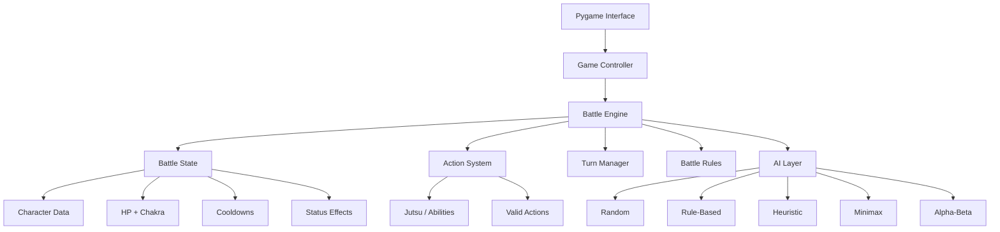

### Design principle

The **battle engine should not depend on a particular AI**.

That means the same battle can be played by:

```text
Human
  ↓
Random AI
  ↓
Rule AI
  ↓
Heuristic AI
  ↓
Minimax
  ↓
Alpha-Beta
```

This makes fair comparison possible.

---

#  04 — Character Model

Initial prototype:

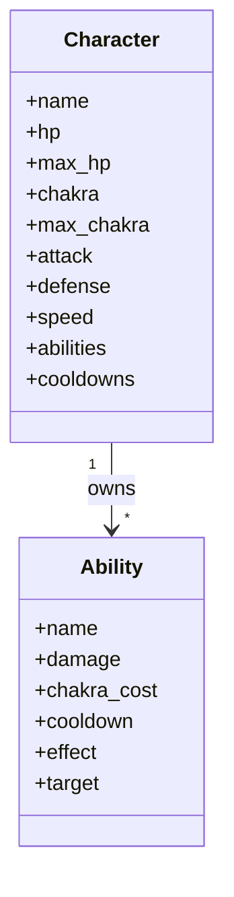

### Initial prototype

| Character | Role |
|---|---|
|  Naruto | Player / AI |
|  Sasuke | Opponent / AI |

We will begin small and expand only after the battle engine is stable.

---

#  05 — Battle Turn Pipeline

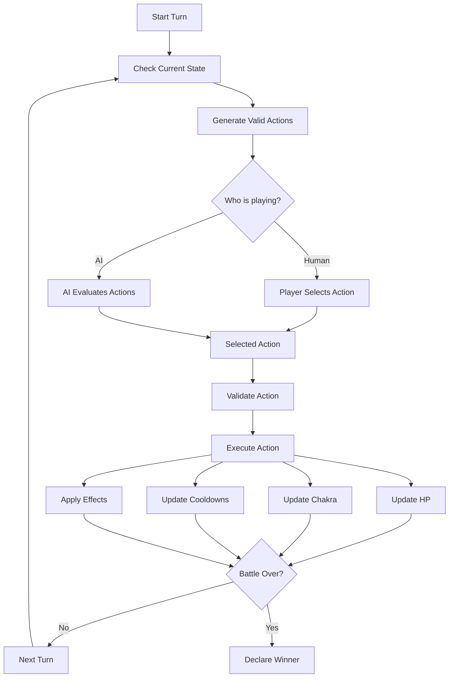

---

#  06 — How the AI Thinks

The most important part of the project is the **decision pipeline**.

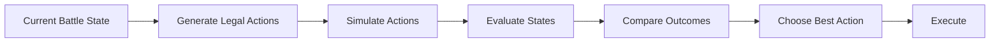

For simple AI, this pipeline is shallow.

For advanced AI, it becomes a **game-tree search**.

---

#  07 — Minimax

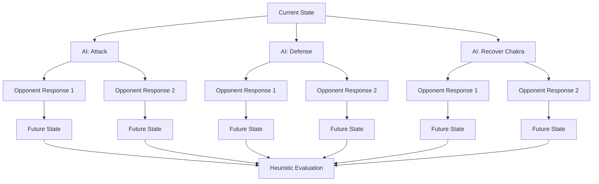

### Minimax idea

> **AI assumes the opponent will respond intelligently.**

So instead of asking:

> "Which attack looks best right now?"

the AI asks:

> "If I do this, what could the opponent do next — and how good is my position afterward?"

---

#  08 — Alpha-Beta Pruning

Minimax can explore a large number of states.

Alpha-Beta pruning removes branches that cannot influence the final decision.

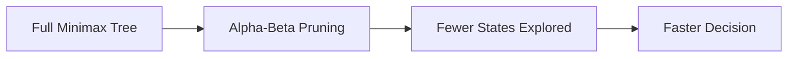

### Experimental question

```text
Same battle
     │
     ├── Minimax depth 2
     ├── Minimax depth 3
     ├── Minimax depth 4
     │
     └── Alpha-Beta depth 4
                 ↓
        Compare search cost
        and decision time
```

The goal is to show that Alpha-Beta can reduce unnecessary exploration **without changing the Minimax result** for the same search configuration.

---

#  09 — Heuristic Evaluation

The AI needs a way to answer:

> **"How good is this battle state for me?"**

Conceptually:

```text
              OWN ADVANTAGE
                    │
       ┌────────────┼────────────┐
       ↓            ↓            ↓
      HP         Chakra      Battle Position
       │            │            │
       └────────────┼────────────┘
                    ↓
              STATE SCORE
                    ↑
       ┌────────────┼────────────┐
       ↑            ↑            ↑
 Opponent HP   Opponent Chakra   Threat
```

Possible factors:

-  Own HP
-  Opponent HP
-  Own Chakra
-  Opponent Chakra
-  Expected damage
-  Defensive advantage
-  Cooldowns
-  Active effects
-  Immediate threat

The exact weights will be decided during implementation and testing.

---

#  10 — Game Modes

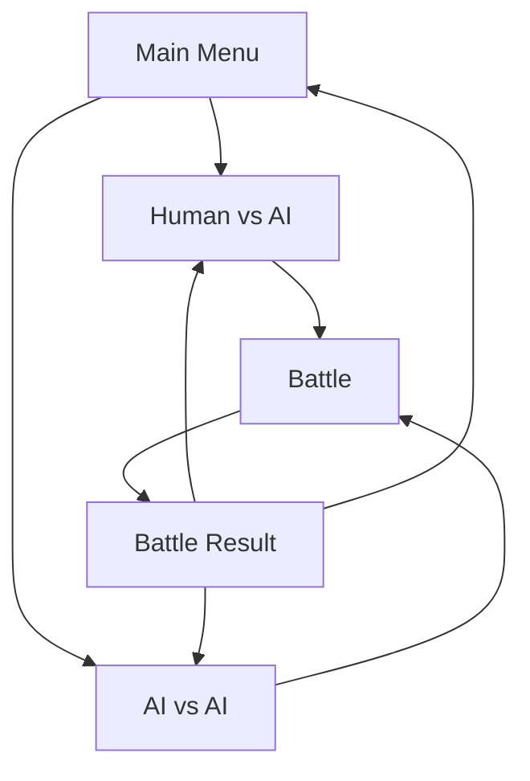

### Human vs AI

Useful for demonstrating the project interactively.

### AI vs AI

More important for **scientific evaluation**, because hundreds of battles can be automated.

---

#  11 — AI Comparison System

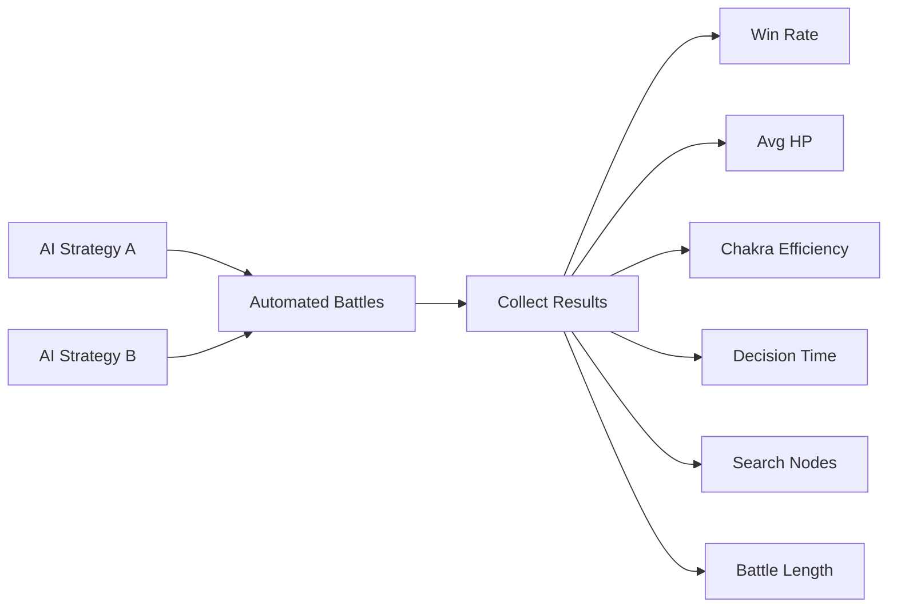

### Metrics

| Metric | Why it matters |
|---|---|
|  Win Rate | Overall effectiveness |
|  Average HP | Survival quality |
|  Average Damage | Offensive effectiveness |
|  Chakra Efficiency | Resource management |
|  Decision Time | Computational cost |
|  Search Nodes | Search complexity |
|  Battle Length | Battle behavior |

---

#  12 — Experimental Pipeline

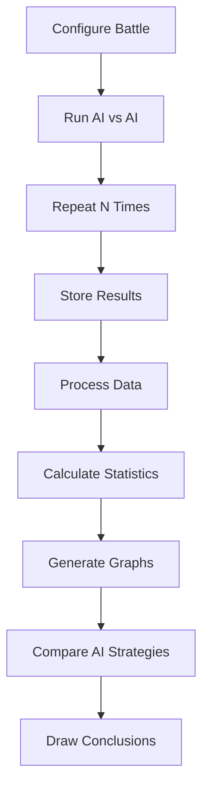

Possible experiments:

```text
Random vs Rule-Based
Random vs Heuristic
Rule-Based vs Heuristic
Heuristic vs Minimax
Minimax vs Alpha-Beta
```

And later:

```text
Alpha-Beta depth 2
Alpha-Beta depth 3
Alpha-Beta depth 4
Alpha-Beta depth 5
```

---

#  13 — Development Roadmap

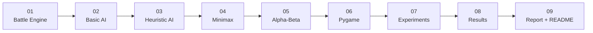

### Phase breakdown

**01 — Battle Engine**
- Character model
- Ability system
- HP
- Chakra
- Cooldowns
- Turns
- Victory conditions

**02 — Basic AI**
- Random
- Rule-Based

**03 — Strategic AI**
- Heuristic evaluation

**04 — Adversarial Search**
- Minimax

**05 — Optimization**
- Alpha-Beta pruning

**06 — Interface**
- Pygame battle UI

**07 — Experiments**
- AI-vs-AI tournaments
- Automated battles

**08 — Analysis**
- Graphs
- Tables
- Performance comparison

**09 — Documentation**
- Final report
- Screenshots
- README
- Project presentation

---

#  14 — Planned Project Structure

We will **not create all of this immediately**.

```text
naruto-battle-ai/
│
├──  Overview.md
├──  requirements.txt
├──  .gitignore
│
├──  src/
│   ├── main.py
│   ├── battle/
│   ├── models/
│   ├── ai/
│   └── data/
│
├──  tests/
│
├──  experiments/
│
├──  assets/
│
└──  README.md          ← created near the end
```

> **Architecture rule:** establish the core structure early, then extend it instead of repeatedly redesigning it.

---

#  15 — Technology Stack

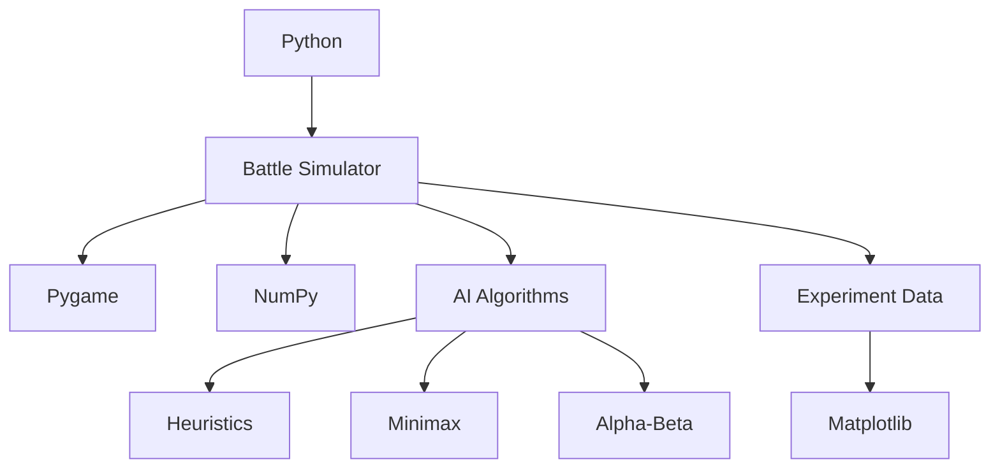

### Main technologies

- **Python** — core implementation
- **Pygame** — graphical interface
- **NumPy** — numerical operations where useful
- **Matplotlib** — experimental visualization
- **JSON / Python data structures** — character and ability data

---

#  16 — Initial Prototype

We start **small**.

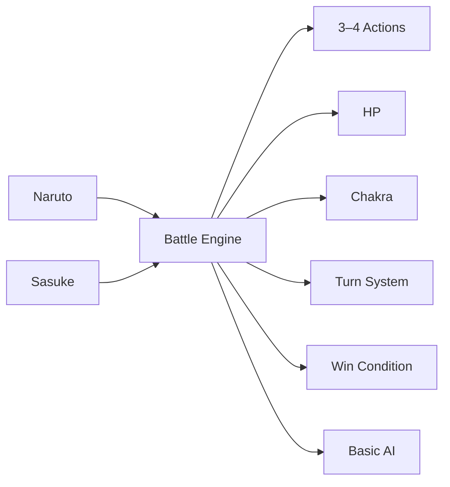

### First milestone

**Naruto vs Sasuke**

with:

- 2 characters
- 3–4 abilities
- HP
- Chakra
- Turn system
- Action validation
- Basic AI
- Battle log
- Victory condition

No fancy GUI yet.

**First make the brain work. Then make it look good.**

---

#  17 — What Makes This More Than a Game?

The project is designed as an **AI experiment wrapped inside a playable game**.

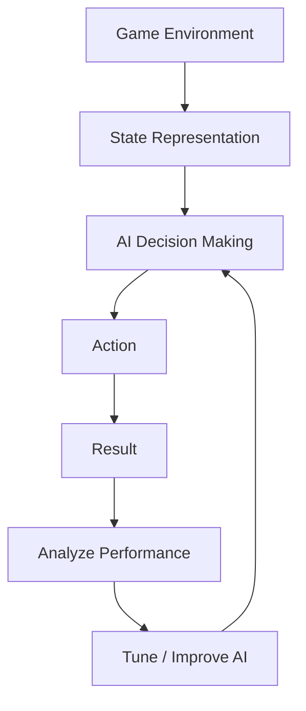

The final project should allow us to investigate:

- Does heuristic reasoning beat random decisions?
- Does Minimax improve decision quality?
- What happens when search depth increases?
- How much work does Alpha-Beta eliminate?
- What is the trade-off between stronger decisions and computation time?

---

#  18 — Final Vision

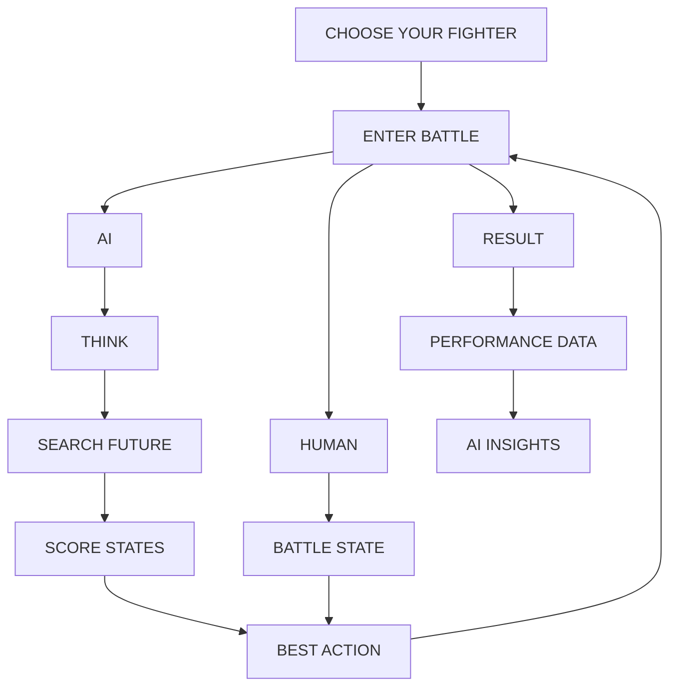

##  The Final Goal

> **Build a battle simulator where the AI doesn't just fight — it reasons.**

The Naruto theme makes the project engaging.

The battle engine makes it playable.

The heuristic system makes it intelligent.

Minimax makes it adversarial.

Alpha-Beta makes it efficient.

The experiments make it an **AI project rather than just a game**.

---

##  Current Status

### ` PROJECT SETUP`

- [x] Project idea finalized
- [x] AI approach planned
- [x] Initial scope defined
- [x] Development pipeline defined
- [ ] GitHub repository initialized
- [ ] Battle engine
- [ ] Character system
- [ ] Ability system
- [ ] Basic AI
- [ ] Heuristic AI
- [ ] Minimax
- [ ] Alpha-Beta
- [ ] Pygame interface
- [ ] AI-vs-AI experiments
- [ ] Results and graphs
- [ ] Final report
- [ ] README

---

###  First Coding Milestone

**Naruto vs Sasuke → Working battle engine → Basic AI**

Everything else builds on that foundation.
